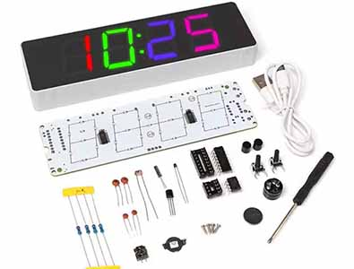

# ⏰ HU-058 WiFi Clock
Hack this [RGB 7-segment clock kit](https://s.click.aliexpress.com/e/_c4nzAME1) into a smart Home Assistant clock, with ESPHome and an ESP32-C3 Super Mini.

<div align="center">
  
</div>

A big thank you to **misterblack1** for his original project - his work inspired this version and made it possible. His repo is linked in the [Credits](#-credits) section at the bottom.

## ✨ Features
- **Full RGB control** - Colour per panel, per digit or per LED, plus gradients
- **12 / 24 hour time** - With an AM indicator in 12 hour mode
- **On-device effects** - Colour Cycle and Flash, smooth even if WiFi drops
- **WiFi status at a glance** - The top colon dot goes out if WiFi drops<br/><br/>
- (Edit) **Auto Brightness** - Light sensor with adjustable Min and Max from Home Assistant
- (Edit) **Colon selector** - Off (steady), Blink or Blink Fast
- (Edit) **World Clock** - Pick each clock's city from Home Assistant, DST included. Build a few for a row of world clocks<br/><br/>
- (Added) **Cycle Temperature** - Shows any Home Assistant temperature sensor between the time - (Auto °C or °F)
- (Added) **Cycle Date** - Shows the date between the time. Follows the clock's city / Time Zone
- (Added) **Date Format** - Manual for DD-MM or MM-DD
- (Added) **OTA indicator** - Shows `OtA` on the display while a firmware update uploads
- (Added) **Boot Indicator** - Shows `LoAd` when ESP32 Starts up
- (Added) **Show Text** - Put up to 4 characters on the display from your automations


## Parts List:
- HU-058 RGB Clock Kit: [AliExpress](https://s.click.aliexpress.com/e/_c4nzAME1)
- ESP32-C3 Super Mini: [AliExpress](https://s.click.aliexpress.com/e/_c2xh5dyV)
- USB-C panel socket: [Amazon](https://link.amazon/B03ckRlzv)
- Everything else I use: [Amazon Shop](https://amzn.to/3uRw8fi)
###### *As an Amazon Associate I earn from qualifying purchases. Some of these are affiliate links. Using them ⇈ provides monetary support at no extra cost to you. Thank you for using them💖

## *Code-y Bits*
- World Clock: [world-clock.yaml](world-clock.yaml)
- Local time only (follows Home Assistant's time zone): [wifi-clock.yaml](wifi-clock.yaml)
- External Component: [components/aip33628](components/aip33628)

#### 🎬 YouTube tutorial: [Coming Soon](#)

## 🔤 The Font
These characters can be shown, in the case you see here:

```
Letters:  A b C c d E F G g H h I i J L l N n O o P q r S t U u y
Digits:   0 1 2 3 4 5 6 7 8 9
Symbols:  - _ = ' "  and a degree sign (° or *)
```

Case is forgiving. If a letter only exists in the other case, that one is used, so `heat`, `HEAT` and `HEAt` all work. The font still picks the shape, so a capital O looks like a zero and `LoAd` reads better than `LOAD`. N and n are both there: `N` is full height and `n` is the short one, so pick whichever reads best.

> **K M V W X Z can't be drawn** on a 7-segment digit, so they show blank.

## 🤖 Actions for automations
Every action is called as `esphome.wifi_clock_<action>`. Durations are in milliseconds, and the display always goes back to the time on its own.

```yaml
# Up to 4 characters, left aligned
action: esphome.wifi_clock_show_text
data:
  message: "HEAt"
  duration: 5000

# A number, with an optional unit. C or F also lights the degree mark
action: esphome.wifi_clock_show_number
data:
  value: 21
  unit: "C"
  duration: 5000
```

There's a ready-to-use example for every action in the [actions](actions) folder. Paste one into a script or automation (or Developer Tools > Actions, in YAML mode) and change the values.

## 🙏 Credits
- Based on [misterblack1/HU-058_ESPHome](https://github.com/misterblack1/HU-058_ESPHome) - the reverse engineering of the AiP33628 LED drivers and the original ESPHome component are his work. Where the code comments mention `docs/`, that's his repo's [docs folder](https://github.com/misterblack1/HU-058_ESPHome/tree/main/docs).
- ESP32-C3 port and additional functions by **3ATIVE**.

---

<div align="center">

### 💖 Support This Project

Found this useful? Want to say thanks and fuel future creations?

**Your support keeps the creativity flowing!** 🍺✨

<table>
  <tr>
    <td align="center">
      <a href="https://www.buymeacoffee.com/3ative">
        
        <br/>
        <b>☕ Buy me a Coffee</b>
      </a>
    </td>
    <td align="center">
      <a href="https://www.patreon.com/3ative">
        
        <br/>
        <b>💖 Join on Patreon</b>
      </a>
    </td>
  </tr>
</table>

**Every contribution helps bring more awesome projects to life!** 🚀

</div>

---
